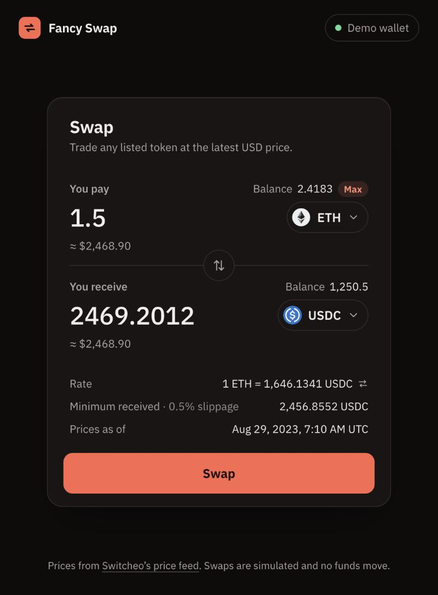
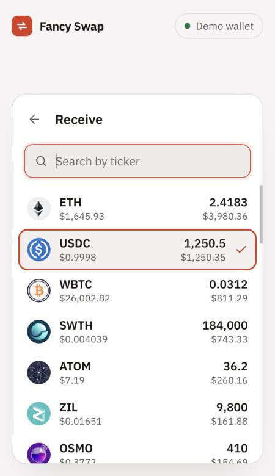

# Problem 2 — Fancy Form

A token swap form built with **Vite + React 19 + TypeScript**. It uses live prices from the
Switcheo feed, the Switcheo token icons, and a mocked swap backend.

| Dark (default)                           | Light (follows OS), mobile                                     |
| ---------------------------------------- | -------------------------------------------------------------- |
|  |  |

```bash
# from the repo root
npm install
npm run dev            # http://localhost:5173
npm test -w src/problem2
npm run build          # type-check + production bundle in src/problem2/dist
```

## What it does

- **Two-way quoting.** Type in either _You pay_ or _You receive_ and the other side is derived from the
  USD prices: `rate = priceFrom / priceTo`.
- **Token picker** with search by ticker (exact → prefix → substring ranking) and full keyboard support
  (↑ ↓ Enter Esc). Tokens you hold are listed first, by USD value.
- **Flip** button. Picking the token that is already on the other side swaps the pair instead of making ETH → ETH.
- **Validation as guidance, not errors-on-load.** The submit button says what's missing
  (_Select a token_ / _Enter an amount_ / _Insufficient ETH balance_ / _Amount too small_). Problems with an
  amount are shown inline, linked to the input via `aria-describedby`.
- **Input sanitising.** Digits and one separator only. `,` works as a decimal separator (`1,5`), and grouped
  numbers pasted from the UI parse as you'd expect (`184,000` → `184000`). At most 8 decimals; paste is
  truncated, not rejected; leading zeros are normalised (`007` → `7`, `.5` → `0.5`).
- **Max** fills your balance; each side shows its fiat value (≈ $…).
- **Rate details**: an invertible rate, minimum received at 0.5% slippage, and the quote's timestamp.
  (The feed is a 2023 snapshot, so the timestamp is shown rather than implying the price is live.)
- **Submit** goes to a mocked backend (1.4 s latency). It shows a spinner, locks inputs, blocks double-submit,
  then updates the demo wallet balances and shows a receipt. Failures keep the user's amounts and say nothing moved.
- **Loading and failure states**: the skeleton matches the card's layout (no jump when prices arrive), and the
  price-feed error has a retry.

## How it's built

```
src/
├── api/
│   ├── prices.ts        fetch + normalise the feed (untrusted input → Token[])
│   └── swap.ts          mock backend (latency + receipt)
├── lib/
│   ├── amount.ts        sanitise / parse / format amounts (rounding direction aware)
│   └── format.ts        Intl formatters for USD, unit prices, token amounts, timestamps
├── hooks/useTokens.ts   one-shot load with abort + retry
├── features/swap/
│   ├── swapState.ts     reducer, quote derivation, validation  ← all pure, unit-tested
│   ├── tokenSearch.ts   ranking + search                       ← pure, unit-tested
│   ├── wallet.ts        demo balances, applying a receipt
│   ├── SwapForm.tsx     orchestration: state, submit lifecycle, picker, focus
│   ├── AmountField.tsx  one "leg" (label, amount, token button, balance, fiat, error)
│   ├── TokenPicker.tsx  combobox + listbox sheet
│   ├── SwapSummary.tsx  rate / minimum received / quote time
│   └── SwapCardStates.tsx  skeleton + load error
├── components/          Icon, TokenIcon (with monogram fallback), Spinner
└── styles/global.css    design tokens (OKLCH, light-dark())
```

### Decisions worth calling out

**One source of truth for the amounts.** State stores only the side the user typed in (`exactSide` +
`exactAmount`). The other field is always _derived_ from the rate, never stored. Two amount fields that
must agree can't drift apart, and flipping just swaps the tokens and the `exactSide`, so the typed amount
stays with its token.

**Rounding always favours the user's expectations.** The amount you receive rounds **down**; the amount
you must pay rounds **up**. So the UI never promises more than the rate gives. Displayed balances,
"minimum received" and receipts truncate for the same reason. Before rounding, values are snapped to 15
significant digits, so float noise can't push a result the wrong way: `0.7 × 10 / 2000` is
`0.0034999999999999996` in floating point and would otherwise truncate to `0.00349999`. Computed fields
show about 8 significant digits (`2057.6676`, not `2057.66766987`) and never use exponent notation, which
`String(1e-7)` would.

**The price feed is treated as untrusted input.** It contains duplicate tickers (USDC ×4, BUSD ×2) with
different prices. The most recent quote wins, and on a timestamp tie the later row wins. Malformed, zero
and negative prices are dropped, as the task allows. Five tickers have different casing in the icon repo
(`STATOM` → `stATOM.svg`). These are mapped after checking every ticker against the repo, and anything
still missing falls back to a generated monogram.

**The picker is a sheet inside the card, not a page modal.** The user stays on the task, but it still
behaves as a modal: `aria-modal`, the form behind it is `inert`, Tab cycles inside it, and Escape closes it
from anywhere. On close, focus goes back to the token button that opened it (`flushSync`, so the form is
no longer inert before `focus()` runs). It follows the WAI-ARIA combobox + listbox pattern: focus stays in
the search box and `aria-activedescendant` tracks the highlighted option. The highlighted option gets a
3:1 accent ring when you navigate with the keyboard, and a `Highlight` outline in forced-colors mode. It
starts on the current token, and Enter during IME composition is ignored.

**The submit button uses `aria-disabled`, not `disabled`.** It stays focusable, so a screen reader user can
reach it and hear _why_ they can't swap ("Insufficient ETH balance"). The submit handler enforces the same
rules. Inline errors sit in polite live regions, so they are announced whichever field you're typing in.
Focus rings use a transparent outline as well as the box-shadow, so they survive Windows High Contrast.

**Design.** The palette is restrained: tinted graphite neutrals, one vermilion accent kept for primary
actions and selection, and amber for validation, so "needs attention" never reads as "brand" (or as a
red "sell"). Every text/background pair passes WCAG AA (≥ 4.5:1) in both themes; I checked them with an
OKLCH→sRGB script. There is one type family, IBM Plex Sans, with tabular figures for numbers. Motion is
used only for state changes (flip, sheet, pending), 150–220 ms with ease-out, and respects
`prefers-reduced-motion`.

**Dependencies are kept small.** The runtime has React and a self-hosted font, with no UI kit, state
library or query library. The data is a one-off snapshot and the form state is a reducer, so they would
add weight without solving a problem. Production JS is ~76 kB gzipped, mostly React DOM.

### Testing

84 tests (Vitest + Testing Library, `jsdom`):

- **Unit**: amount sanitising (comma decimal vs grouping), directional rounding and float noise, truncating
  display formatters, feed normalisation (duplicates, ties, junk rows), reducer
  transitions, quote derivation in both directions, validation order, search ranking, balance updates
  without float drift.
- **Integration** (rendered, driven with `user-event`): two-way quoting, rejected keystrokes, inline
  balance error and its accessible description, Max, flip, keyboard token selection with focus return,
  the picker's Tab trap and initial option, Escape and the empty state, pending → success with balance update and double-submit guard, failure
  path, and app-level loading → success and error → retry (with focus moved to the form).

## Assumptions and trade-offs

- **Balances are mocked** (the "Demo wallet"). A real app would read them from the connected wallet.
- **Amounts use JS numbers.** That is fine for a UI that quotes off floating-point USD prices. A real
  integration would carry amounts as integer base units (`bigint`) with each token's decimals, and only
  format at the edges.
- **No fee or price impact.** The feed gives spot prices only. The 0.5% slippage tolerance is a fixed
  constant used for "minimum received".
- **Prices are fetched once.** With a live feed I'd re-quote on an interval and before submit, and warn if
  the price moved beyond the slippage tolerance.

### With more time

- Playwright e2e and visual-regression snapshots across both themes and phone and desktop widths.
- A slippage setting, a review/confirm step for large trades, and recent-token chips in the picker.
- i18n of copy and number formats (formatting is already centralised in `lib/format.ts`).
